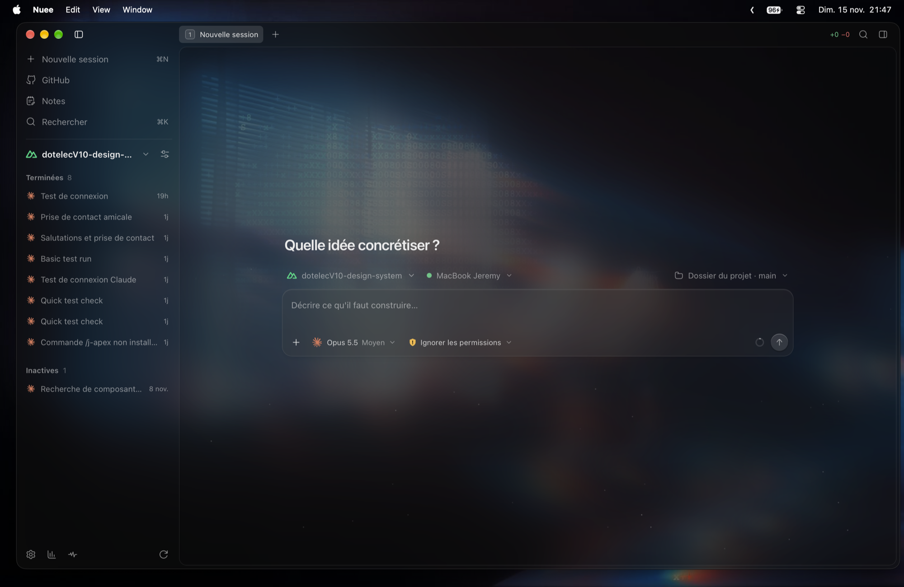

# Nuée

A desktop app to run several Claude Code sessions side by side, each with its own project, browser, terminal and Git panel.



## Features

- **Sessions in tabs**: one per task, grouped by project, restored on restart, optionally in their own Git worktree.
- **Side panels**: a real browser Claude can drive, a terminal, a file explorer and a Git panel (diff, commit, push, pull).
- **Orchestration**: Claude can start, read and message other sessions to split a job into parallel tasks.
- **Dev servers**: start the commands from `.claude/launch.json` and stop leftover processes in one click.
- **Usage and notes**: rate limits, cost and tokens at a glance, plus Markdown notes you can hand back to Claude.

## Download

Get the latest version from [Releases](https://github.com/jeremy-prt/nuee/releases/latest).

- **macOS**: the app is not signed by Apple. On first launch, right-click the app and choose **Open**, or run `xattr -cr /Applications/Nuée.app`.
- **Windows**: if SmartScreen blocks it, click **More info > Run anyway**.
- **Linux**: AppImage or `.deb`.

## Requirements

- [Claude Code](https://code.claude.com) installed and signed in (`claude` on your `PATH`).
- Git.
- Optional: [GitHub CLI](https://cli.github.com) (`gh`) to clone your repositories.

## Build from source

Needs Node, pnpm, Rust and the [Tauri prerequisites](https://v2.tauri.app/start/prerequisites/).

```bash
pnpm install
pnpm tauri dev     # run
pnpm tauri build   # build for the current OS
```

## Translations

English, French, Spanish, Portuguese (Brazil), Japanese and Simplified Chinese. To add one, copy `src/i18n/locales/en.ts` and register it in `src/i18n/index.ts`.

## License

[MIT](LICENSE)
